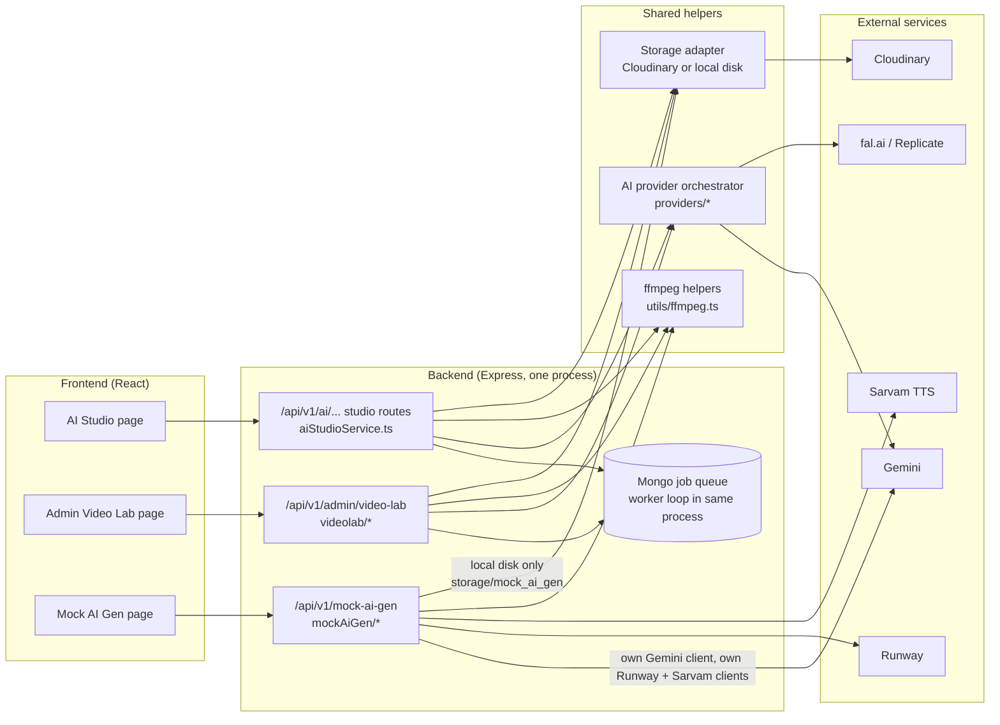
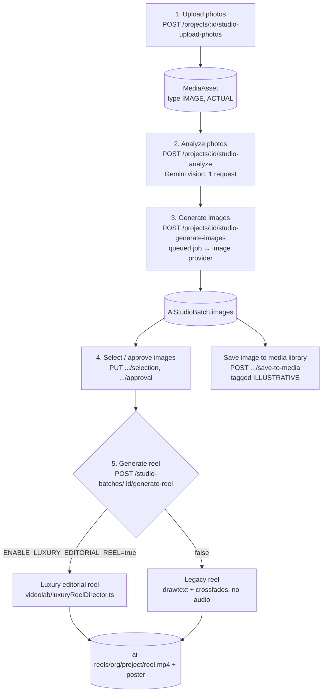
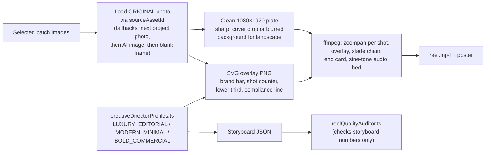
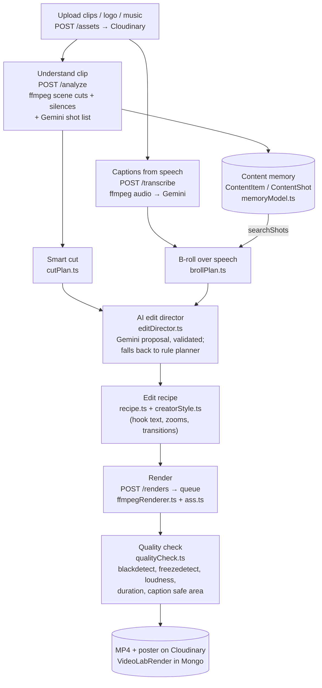
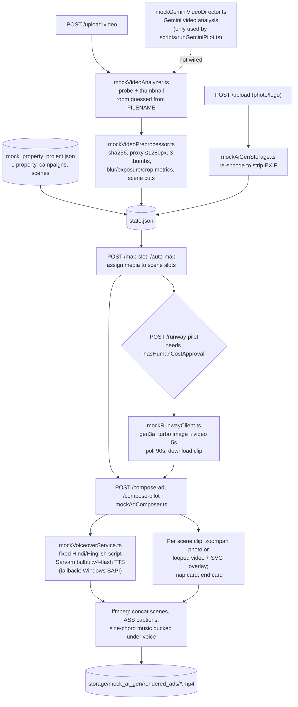

# Generation Architecture (as of 2026-11-20)

How RealCRM makes images and videos **today**, on branch `feat/ai-video-director`.
This is a snapshot of what the code does now, including the parts that are placeholders.
For where we are going next, read `VIDEO_PIPELINE_PLAN.md`. For Video Lab details, read `VIDEO_LAB.md`.

---

## 1. The big picture

There are **three separate generation pipelines**. They share the same helpers (Gemini, ffmpeg, storage) but do not call each other.

| # | Pipeline | Who uses it | Input | Output | Maturity |
|---|---|---|---|---|---|
| A | **AI Studio** | Client users, inside a project | Project photos | AI marketing images + a photo reel | In the product |
| B | **Video Lab** | Platform admin only (`/admin/video-lab`) | Raw phone clips, logo, music, typed facts | Edited 9:16 reel with captions from speech | Admin testing, real AI |
| C | **Mock AI Gen sandbox** | Anyone (`/mock-ai-gen`, no login) | One sample property JSON + uploaded clips/photos | Scripted ad with voiceover, map, end card | Experiment, mostly placeholders |

---

## 2. Shared building blocks

| Block | File(s) | What it does | Rule |
|---|---|---|---|
| AI provider | `src/modules/ai/providers/aiProviderOrchestrator.ts`, `geminiProvider.ts`, `falAiProvider.ts`, `replicateAiProvider.ts`, `enhancedLocalProvider.ts` | Text, JSON, captions, photo analysis → **Gemini**. Image-to-image → `IMAGE_TO_IMAGE_PROVIDER` (`auto` = fal → Replicate → Gemini; `local` only when set explicitly). | No fake output: when a provider fails, the error (`AI_NOT_CONFIGURED`, `AI_QUOTA_EXCEEDED`, …) goes back to the user. |
| Gemini daily limit | `GEMINI_DAILY_LIMIT` (default 20) | Free tier budget for the POC (~20 requests a day). | All Gemini calls should go through the provider so they are counted. |
| ffmpeg | `src/utils/ffmpeg.ts` | `runFfmpeg`, `spawnFfmpeg`, `spawnFfprobe`, `spawnMediaTool`, `probeMedia`, `escapeFilterPath`. Runs locally (`FFMPEG_PATH`) or in the `realcrm-media-tools` Docker container (`MEDIA_TOOLS=docker`). | New code must use these helpers and keep files inside the backend folder, or Docker mode breaks. |
| Fonts | `assets/fonts/` (Noto Sans, Devanagari, Gurmukhi) | Correct Hindi / Punjabi shaping in captions (libass + HarfBuzz). | Pass `fontsdir` to the subtitles filter; don't rely on Windows fonts. |
| Storage | `src/storage/localStorage.adapter.js` (`defaultStorage`) | Saves to Cloudinary when configured, keeps a local cache under `storage/`. `/storage/*` serves local files or redirects to Cloudinary. | Sandbox files (`storage/mock_ai_gen/`) are never sent to Cloudinary. |
| Job queue | `src/queue/jobQueue.ts`, `src/worker.ts` | Mongo-backed queue. The worker loop runs inside the API process. | Long renders go through the queue, not the HTTP request. |

---

## 3. Pipeline A: AI Studio (client product)

**Code:** `src/modules/ai/aiStudioService.ts`, routes in `src/modules/ai/routes.ts` (mounted at `/api/v1/ai`).

| Step | AI / API | Notes |
|---|---|---|
| Upload | none | sharp reads size; thumbnail 400px webp; category guessed from filename; first photo becomes project cover. |
| Analyze | Gemini (vision, one request for up to 12 photos) | Room category, features, camera angle. |
| Generate images | fal.ai / Replicate / Gemini image (per `IMAGE_TO_IMAGE_PROVIDER`) | Runs as a queued job; progress at `/studio-batches/:id/progress`. |
| Reel (luxury) | none (ffmpeg + sharp) | See below. |
| Reel (legacy) | none (ffmpeg) | Text burned with drawtext, crossfades, silent. |

### Luxury editorial reel (`luxuryReelDirector.ts`)

- Shot length, transition and end card length come from the chosen profile.
- Profile choice: user style (`CINEMATIC_SHOWCASE` → editorial, `LUXURY_PRESENTATION` → minimal, `MODERN_PROMO_AD` → bold), otherwise by project category/subtype.
- Text stays out of the top 180 px and bottom 380 px (platform UI zones).

---

## 4. Pipeline B: Video Lab (admin, real AI)

**Code:** `src/modules/videolab/*`, API at `/api/v1/admin/video-lab` (platform admin only). Full details in `VIDEO_LAB.md`.

| File | Role |
|---|---|
| `analyze.ts` | Clip understanding: hard cuts, pauses, Gemini shot list, thumbnails |
| `transcribe.ts` | Timed captions from speech (Hindi, Punjabi, Hinglish, English) |
| `photoAnalysis.ts` | One Gemini request for a batch of project photos |
| `cutPlan.ts` | Picks shots and order for a target length, never cuts mid-sentence |
| `brollPlan.ts` | Speech blocks as the backbone, matching B-roll by spoken keywords, pulls from content memory |
| `editDirector.ts` | Builds an "edit sheet", asks Gemini for an edit, validates it, falls back to the rule planner |
| `creatorStyle.ts` | Hook text, punch-in zooms, short crossfades |
| `memoryModel.ts`, `memorySearch.ts`, `cacheModel.ts` | Content memory (text cards per clip and shot) and analysis cache |
| `recipe.ts` | Engine-independent edit recipe, variants, caption timing |
| `ass.ts` | Subtitle files with correct Indic fonts |
| `ffmpegRenderer.ts` | The render (1080×1920, captions, watermark, end card, music ducked under speech) |
| `qualityCheck.ts` | Real checks on the rendered file |
| `uploadFeedback.ts` | Upload warnings and shot issue summaries |

Gemini cost: about 5–6 requests per video (see `VIDEO_PIPELINE_PLAN.md`).

---

## 5. Pipeline C: Mock AI Gen sandbox (experiment)

**Code:** `src/modules/mockAiGen/*`, API at `/api/v1/mock-ai-gen` (**no login**), page `/mock-ai-gen` (**no login**).
State lives in one shared file `storage/mock_ai_gen/state.json`; the property comes from `mock_property_project.json`. Nothing is written to MongoDB.

| Endpoint | What it does |
|---|---|
| `GET/PUT /project`, `GET /state` | Read / replace the sample property (Zod validated) |
| `POST /upload`, `/upload-video` | Upload photo/logo or video (150 MB, held in memory) |
| `POST /rotate-asset`, `/preprocess-all` | Re-run preprocessing (rotation override) |
| `POST /update-classification`, `/map-slot`, `/auto-map` | Room labels and slot mapping |
| `GET /campaigns` | Campaigns from the fixture |
| `POST /runway-pilot`, `GET /runway-status/:taskId` | Paid Runway image-to-video |
| `POST /compose-ad`, `/compose-pilot` | Render an ad / the 12.5 s style-match pilot |
| `POST/DELETE /reset` | Delete all sandbox files and state |
| `GET /files/*` | Serve sandbox files (path traversal blocked) |

---

## 6. External services and settings

| Service | Used by | Env vars | Cost today |
|---|---|---|---|
| Gemini | A (analysis, image gen option), B (all AI), C (scripts only) | `GEMINI_API_KEY`, `GEMINI_TEXT_MODEL`, `GEMINI_IMAGE_MODEL`, `GEMINI_ANALYSIS_MODEL`, `GEMINI_DAILY_LIMIT`, `AI_PROVIDER` | Free tier, ~20 req/day |
| fal.ai / Replicate | A (image-to-image) | `IMAGE_TO_IMAGE_PROVIDER`, `FAL_KEY`, `REPLICATE_API_TOKEN`, `CONTROLNET_MODEL` | Paid per image |
| Runway | C | `RUNWAYML_API_SECRET` or `RUNWAY_API_KEY` | ~$0.25 per 5 s clip |
| Sarvam TTS | C | `SARVAM_API_KEY` (package `sarvamai`) | Paid per character |
| Cloudinary | A, B | `CLOUDINARY_*` | Free tier |
| ffmpeg | A, B, C | `FFMPEG_PATH` or `MEDIA_TOOLS=docker` | Local |

Feature switches: `ENABLE_LUXURY_EDITORIAL_REEL` (A), `FEATURE_AI_VIDEO_DIRECTOR` (C preprocessing, default on), `AI_DIRECTOR_BUDGET_CAP_USD` (C Gemini director, in-memory), `AI_DAILY_COST_CAP_USD`, `AI_MAX_VIDEO_SECONDS_PER_REEL`, `REEL_MUSIC_PATH`.

---

## 7. Where files go

| Path | Contents |
|---|---|
| `media/<org>/<project>/…` | Uploaded project photos and thumbnails (A) |
| `ai-reels/<org>/<project>/<reel>.mp4`, `_poster.jpg` | AI Studio reels (A) |
| `video-lab/assets/…`, render outputs | Video Lab inputs and outputs (B), on Cloudinary |
| `storage/scratch/…` | Temporary render folders (A, B) |
| `storage/mock_ai_gen/{uploads,thumbnails,preprocessed,runway_clips,rendered_ads,audio}` | Sandbox (C), local disk only |

---

## 8. What is real and what is a placeholder (today)

| Part | Real | Placeholder / known problem |
|---|---|---|
| A: photo analysis, image generation | Yes (Gemini, fal/Replicate) | — |
| A: luxury reel rendering | Yes (renders in seconds) | Uses original photos, not the chosen AI images; falls back to another photo or a blank frame; default text "Chandigarh / RS Heritage / RS Group"; "ACTUAL PHOTO" and "Verified" labels on every frame; project names with `&` crash the render; music is a sine chord |
| A: quality audit | No | Scores are fixed numbers from the storyboard, not the video |
| B: everything in section 4 | Yes | See `VIDEO_PIPELINE_PLAN.md` for next steps |
| C: preprocessing (hash, proxy, thumbs, scene cuts) | Yes | 180°-tagged clips come out upside down; "camera stability" is a guess |
| C: clip analysis | No | Room from filename, fixed quality 9/10 and fixed highlight times; the Gemini analyzer is not wired in |
| C: narration | No | Fixed script with invented facts (expressway/metro distances, "German fittings", "RERA approved") |
| C: voiceover | Partly (Sarvam) | Only the first scene's voice survives the mix (`amix duration=first`); Windows-only fallback |
| C: captions | Partly | Show the English scene text while the voice speaks Hindi; no word animation |
| C: Runway | Yes (paid) | Unmapped scene uses the first upload; 90 s timeout reports failure while the task keeps running |
| C: access | — | No login on the API or the page |

---

## 9. Rules for anyone changing generation code

1. **No fake output.** If AI or a file is missing, return a clear error. No placeholder images, default cities or invented facts in anything a client can publish.
2. **Facts come from the project record only** (name, city, BHK, area, RERA number, distances). If a fact is missing, leave it out.
3. **Label honestly.** "Actual photo" only on `ACTUAL` media; AI images stay `ILLUSTRATIVE`. Use "RERA Reg. No." wording.
4. **All Gemini calls go through the AI provider** so the daily limit and errors work the same everywhere.
5. **All ffmpeg/ffprobe calls go through `src/utils/ffmpeg.ts`** and use files inside the backend folder (Docker mode).
6. **Use `assets/fonts` and `escapeFilterPath`** for captions; never Windows-only fonts or hand-made escaping.
7. **Paid APIs (Runway, Sarvam, fal) need login, a role check and a server-side budget**, never a flag sent by the browser.
8. **Long work goes through the job queue**, not a blocking HTTP request.
