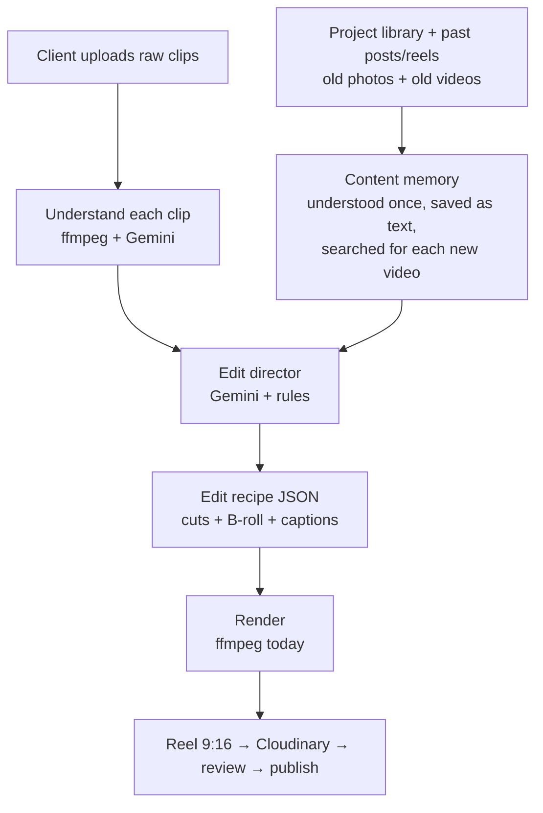
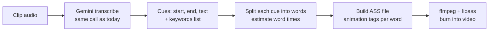
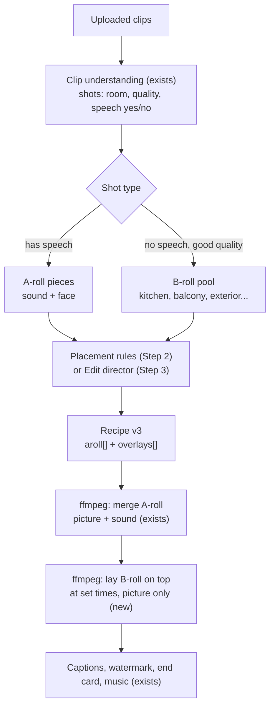
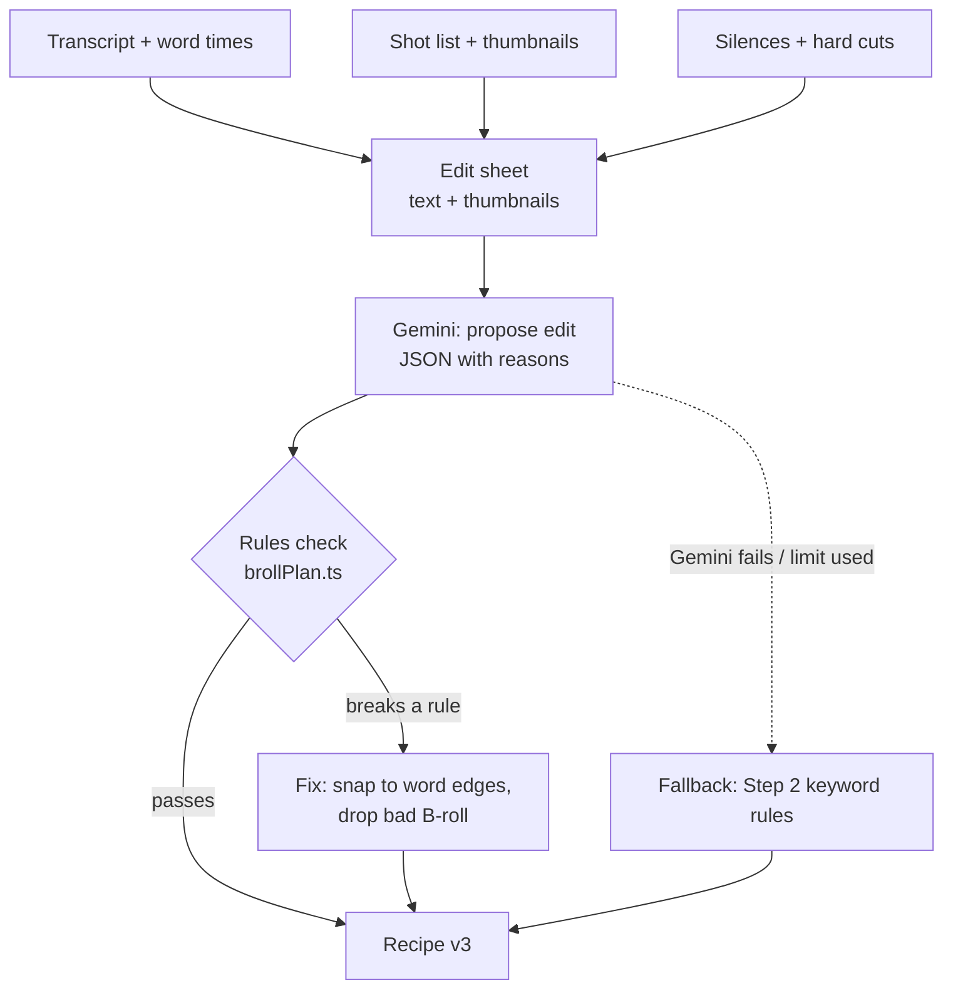
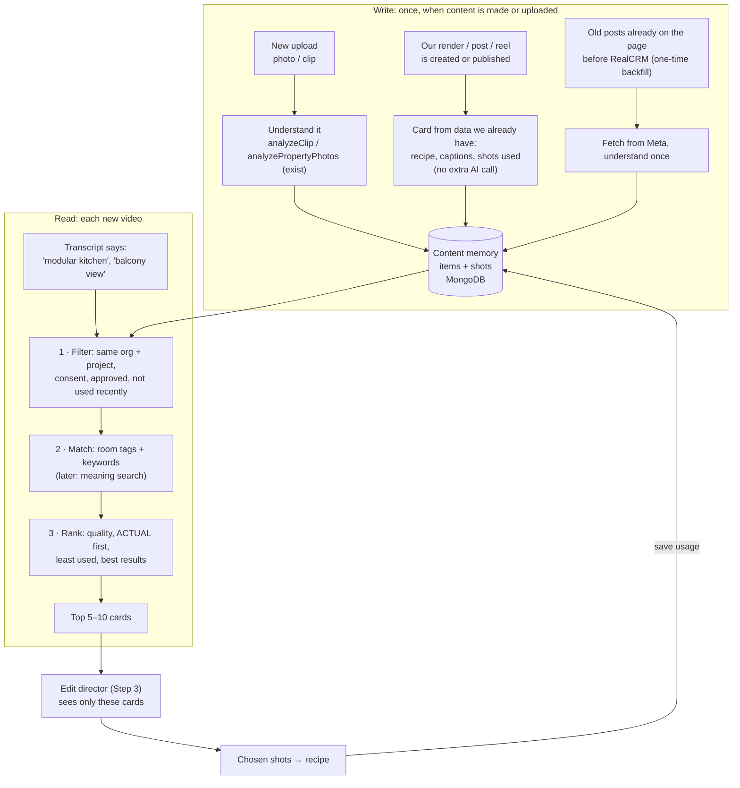
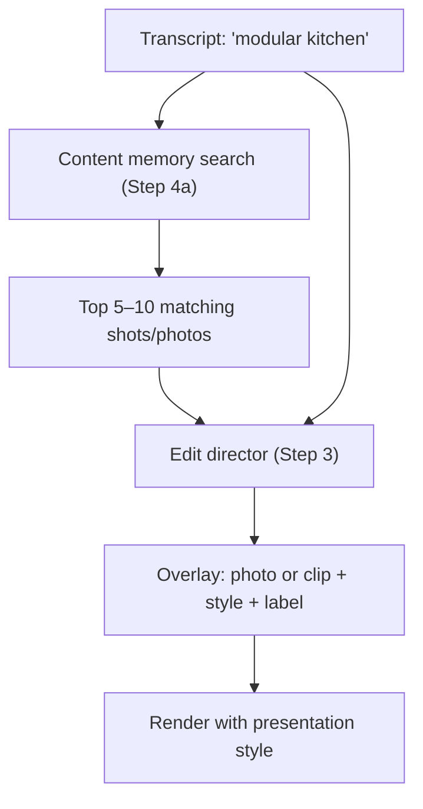
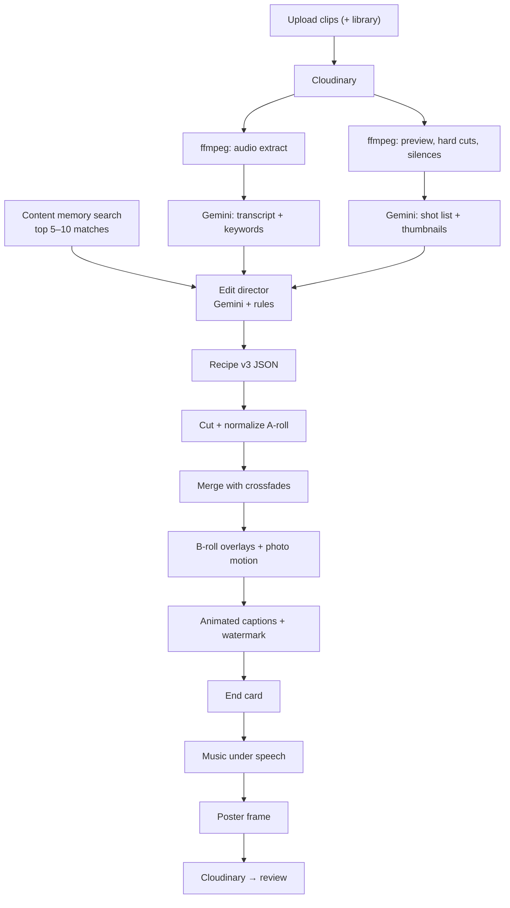
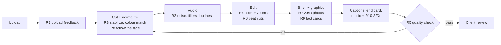

# Video Pipeline Plan: steps, tech and APIs

Last updated: 5 Nov 2026

This is the plan for the next stages of video editing. It's written so another developer or an AI coding tool can pick up any step and know what to build, with which tools, and how to check that it works.

- What already exists and how it works: `VIDEO_LAB.md`
- AI providers, prices, research: `AI_GENERATION_RESEARCH.md`
- The whole app: `OVERVIEW.md`

---

## 0. The goal in one picture

A client sends raw phone videos (often someone talking to the camera). We return a reel that looks like a human editor made it:

- **Animated captions** (word-by-word, keywords in brand colour), not plain white text on a black box.
- **Smart cuts**: bad parts removed, best parts kept, never cut in the middle of a sentence.
- **B-roll over speech**: while the presenter keeps talking, the picture switches to the thing being talked about.
- **Uses the project's library**: if the presenter says "see the kitchen", we show the kitchen, taken from this clip, from **older videos**, or from **older photos** of the same project, presented nicely (slow zoom, card, label).
- Branded: watermark, end card with phone and RERA, music lowered under speech.



### Rule for the proof of concept (POC): free only

| Need | POC (free) | Production (paid, later) |
|---|---|---|
| Understanding clips, captions, edit decisions | Gemini free tier (~20 requests/day, enough for the POC) | Gemini with billing on |
| Rendering | ffmpeg (free, on our machine) | Decide after the engine comparison (Step 5) |
| Word timing for captions | Estimated from the caption timing (free) | whisper.cpp (free, local) or Sarvam (paid) |
| Storage | Cloudinary (current account) | Same |
| AI motion from photos, voiceover | Not in the POC | Veo / Sarvam Bulbul (Step 8) |

---

## 1. Do we need a fallback AI?

**Short answer: not another paid AI right now. We need a "no AI" fallback, and a free local speech model later.**

| If Gemini fails or the daily limit is used up | Fallback | Cost |
|---|---|---|
| Clip understanding | Rules only: ffmpeg hard cuts + silences → cut in the quiet gaps. Already partly there in `cutPlan.ts`. No room names, so no smart B-roll. | Free |
| Captions from speech | **whisper.cpp** on our machine (OpenAI Whisper model, runs offline on the Mac). Good for Hindi and English and gives word timing. Weaker for Punjabi, and Hinglish needs a conversion step to Roman letters. | Free |
| Edit director (Step 3) | Rules only: keyword list (kitchen / रसोई / ਰਸੋਈ → kitchen shots). | Free |
| Text (captions, scripts) | Not needed in the POC. | — |

Why not add a second LLM now:
- The 20/day limit is enough for the POC if we **save every analysis** and never ask Gemini twice for the same clip (see the budget in section 9).
- All AI calls already go through one interface (`src/modules/ai/providers/provider.interface.ts`). Adding another provider later means one new file, with no changes anywhere else.
- If we want a free online backup later, options to check (free limits change, so verify first): **Groq** (hosted Whisper for audio, Llama for text) and **OpenRouter** free models. For vision on our own machine: **Ollama** with a vision model (for example Qwen2.5-VL), slower and less accurate than Gemini.

**Rule that stays:** no fake output. If every option fails, the step shows a clear error (see `src/utils/aiErrors.ts`). We never invent captions or room names.

---

## 2. Step order

Each step is built, tested in the Video Lab, and accepted before the next one starts.

| Step | What | Depends on | Status |
|---|---|---|---|
| 0 | Current Video Lab: ffmpeg render, speech captions, clip understanding, smart cut | — | ✅ Done |
| **1** | **Animated captions** (word-by-word pop, karaoke highlight, keyword colour) | 0 | Next |
| **2** | **B-roll over speech** using shots from the uploaded clips | 0 | Planned |
| **3** | **Edit director**: AI decides cuts and B-roll placement from timestamps + thumbnails + transcript, checked by rules | 2 | Planned |
| **4a** | **Content memory**: a text "knowledge card" for every post, reel, video, photo and shot, saved once and searched (RAG), so the AI never re-reads all old content | 3 | Planned |
| **4b** | **Project library as B-roll**: old photos and videos found through content memory, matched to what is said, shown in good styles | 4a | Planned |
| 5 | Engine comparison: ffmpeg vs Remotion vs Shotstack/Creatomate, same recipe | 1–4 | Planned |
| 6 | Caption engine comparison: Gemini vs whisper.cpp vs Sarvam | 1 | Planned |
| 7 | Connect to the real client flow: plan slot → reminder → edit → approval → publish | 5 | Planned |
| 8 | AI path when the client sends nothing: AI motion from photos, voiceover (paid) | 7 | Later |
| R | **Realism upgrades** (section 11): shooting guide, audio cleanup, stabilization + colour match, creator-style editing, automatic quality check, and more. Each one is built next to the step it belongs to (see the "Fits with" column there). | — | Planned |

The **edit recipe** (plain JSON, see `recipe.ts`) stays the centre of everything. AI and rules write the recipe, and the renderer only reads it. That's why we can swap the renderer in Step 5 without redoing Steps 1–4.

---

## 3. Step 1: Animated captions

### What the viewer sees
Today: a full line of white text on a dark box or with an outline, fading in and out.

After:

| Preset | Look |
|---|---|
| `POP` | 2–4 words at a time. The word being spoken pops (grows slightly and bounces back) and turns the brand colour. The usual reel style. |
| `KARAOKE` | The full line is visible, and each word fills with colour as it is spoken. |
| `SLIDE` | Each line slides up into place with a soft box. Calmer, for luxury brands. |
| `MINIMAL` | Today's look (kept as an option). |

On top of any preset: **keywords** like "3 BHK", "₹85 lakh", "Mohali", "RERA" or "ready to move" are bigger and in the accent colour.

### Flow



### Tech

| Part | Tech | API | Free? |
|---|---|---|---|
| Transcript + keywords | Gemini (`GEMINI_TEXT_MODEL`). **Add `keywords` to the existing transcribe prompt**, so it costs no extra request. | Gemini API | Free tier |
| Word timing (v1) | Split each cue's time across its words by word length. Cues are short (2–6 words), so this looks right. | — | Free |
| Word timing (v2, Step 6) | whisper.cpp word timestamps, or Sarvam Saaras | local / Sarvam API | Free / paid |
| Animation | **ASS subtitle tags rendered by libass** (already used): `\k` karaoke fill, `\t(...)` grow/bounce, `\move` slide, `\c` colour, `\fad` fade | — | Free |
| Render | Existing ffmpeg step "Captions + watermark" | — | Free |

### Rules
- **Hindi and Punjabi: split only at spaces, never inside a word.** Colouring part of a Devanagari or Gurmukhi word breaks the joined letters. Per-word styling is safe as long as each word stays whole.
- Keep captions above Instagram's bottom bar (current `MarginV 420`), and at most 2 lines.
- Keyword colour = the brand accent colour from the end-card template.
- If there are no word times, fall back to whole-cue animation (fade + slide), never to nothing.

### Code to change
- `src/modules/videolab/transcribe.ts`: ask for `keywords` with the cues.
- `src/modules/videolab/recipe.ts`: `CaptionStyle` gets `POP | KARAOKE | SLIDE | MINIMAL`; cues can carry `words[]` and `keywords[]`.
- `src/modules/videolab/ass.ts`: new builders per preset.
- `AdminVideoLabPage.tsx`: preset picker, shown per variant.
- Tests: `tests/videolab_recipe.test.ts`, word split, no split inside Indic words, ASS output per preset.

### Done when
A Hinglish and a Hindi test clip render with each preset, words light up in time with speech (by eye), Hindi letters are not broken, and keywords show in the accent colour.

---

## 4. Step 2: B-roll over speech

### What it means
Every reel has two kinds of footage:
- **A-roll**: the presenter talking to the camera. **Its sound is the backbone of the video.**
- **B-roll**: footage of the thing being talked about (rooms, view, amenities).

"B-roll over speech" means the **presenter's voice keeps playing**, but the **picture switches** to a room shot for a few seconds, then comes back to the presenter's face.

```
Time      0s ──────── 3s ──────── 6s ──────── 9s ──────── 12s
Sound     [presenter: "Welcome... this modular kitchen... and the balcony view..."]  (never cut)
Picture   [ presenter face ][ KITCHEN shot ][ face ][ BALCONY shot ][ face ]
Captions  [ animated captions on top the whole time                         ]
```

Today the smart cut can only put B-roll **between** speech, so the sound stops while a room is shown. Real reels don't do that.

### Flow



### Recipe change (version 3)
```json
{
  "version": 3,
  "aroll": [ { "key": "…/talk.mp4", "start": 0.0, "end": 14.2, "cues": [] } ],
  "overlays": [
    { "start": 3.1, "end": 6.0, "source": { "kind": "clip", "key": "…/tour.mp4", "in": 12.4, "out": 15.3 },
      "style": "FULL", "label": "Modular kitchen", "reason": "said 'kitchen' at 3.2s" },
    { "start": 8.4, "end": 11.0, "source": { "kind": "photo", "key": "…/balcony.jpg" },
      "style": "CARD", "motion": "ZOOM_IN", "label": "Balcony view" }
  ]
}
```
Times in `overlays` are on the final timeline. `source.in/out` are times inside the B-roll clip. The overlay sound is always muted.

### Placement rules (used in Step 2, and to check the AI in Step 3)
1. The first 2–3 s show the presenter's face (the hook). No B-roll.
2. Each B-roll piece lasts 1.5–4 s. At least 1.5 s of face between two B-roll pieces.
3. B-roll covers at most about 60% of the speaking time. People trust a face.
4. Start and end B-roll at **word boundaries** (from the caption cues), never mid-word.
5. Only use a shot whose room matches what is said. **If nothing matches, show the face.** No B-roll is better than wrong B-roll.
6. Never the same shot twice in one video. No B-roll on the end card.
7. Step 2 matches with a **keyword list** only (no AI): kitchen / किचन / रसोई / ਰਸੋਈ → `KITCHEN`, bedroom / बेडरूम → `BEDROOM`, balcony, living, bathroom, pool, gym, park, parking, lobby, exterior, view. The keyword list doubles as the free fallback for Step 3.

### Tech

| Part | Tech | API | Free? |
|---|---|---|---|
| Find A-roll vs B-roll | Existing clip understanding (`analyze.ts`: shots with room, quality, speech) | Gemini | Free tier |
| Placement | Rules + keyword list (new `brollPlan.ts`) | — | Free |
| Render | ffmpeg `overlay` filter with `enable='between(t,start,end)'` and short alpha fades; B-roll scaled/cropped to 1080×1920 | — | Free |

### Code to change
- New `src/modules/videolab/brollPlan.ts`: rules above, pure functions, unit-tested.
- `recipe.ts`: recipe v3 types (`aroll`, `overlays`). Keep reading v2 recipes.
- `ffmpegRenderer.ts`: new step between "Merge clips" and "Captions + watermark".
- `AdminVideoLabPage.tsx`: timeline preview showing face/B-roll blocks with the reason for each.
- New `tests/videolab_broll.test.ts`.

### Done when
A talking clip plus a tour clip render with the voice never cut, room shots appear while the matching room is mentioned, and every rule above passes in tests.

---

## 5. Step 3: Edit director (AI decides cuts and B-roll)

### Idea
The keyword list from Step 2 is dumb: it can't tell "the kitchen is next to the dining area" from "we don't have a kitchen photo yet". We give Gemini a compact "edit sheet" of what we know and let it propose the edit. **Rules then check the proposal and fix or reject it.**

What Gemini receives (one request per video):
- Transcript with times (from Step 1).
- Shot list with times, room, quality, problems, and a **small thumbnail per shot** (already made by `analyze.ts`).
- Silences and hard cuts (exact, from ffmpeg).
- Target length (15/30/45/60 s) and the rules from Step 2 in plain words.

What it returns: an edit decision list (JSON): which A-roll parts to keep, where each B-roll goes, and a one-line reason for each.



### Tech

| Part | Tech | API | Free? |
|---|---|---|---|
| Edit proposal | Gemini, JSON output (`generateJson` in the provider) | Gemini | Free tier (1 request per video) |
| Check and fix | `brollPlan.ts` rules from Step 2 | — | Free |
| Fallback | Keyword rules (Step 2) + existing `cutPlan.ts` | — | Free |

### Done when
On 3 test videos, the AI edit is judged better than or equal to the keyword edit, it never breaks a rule after checking, and with Gemini switched off the keyword edit still renders.

---

## 6. Step 4a: Content memory (search past posts, reels and footage)

### The problem
After a few months a project has dozens of posts and reels, plus hundreds of photos and clips. For each new video, the AI should not watch or read all of them again:
- **Slow:** every old video has to be downloaded and sent again.
- **Costly:** thousands of tokens per old video, and the free tier is ~20 requests a day.
- **Worse results:** a prompt stuffed with 200 items makes the AI pick worse.

### The solution: describe everything once, then search the text
When anything is **made or uploaded**, we save a short text "knowledge card" about it, at two levels:

| Level | One record per | What's saved |
|---|---|---|
| **Item** | post, reel, video, photo | type, project, date, platform, caption text, hook, content type (walkthrough, offer, festival…), language, rooms shown, summary, which source files it used, ACTUAL/ILLUSTRATIVE, consent, and later its **results** (reach, leads) |
| **Shot** | each shot inside a video (one clip can have 5–20) | start/end time, room, visible features ("island counter", "pool view"), quality score, problems, spoken words during the shot, 1 thumbnail, where it has been used (post ids + dates) |

We save **shots, not every frame**: a shot (a few seconds of one view) is the unit an editor actually uses, and one thumbnail per shot is enough to show and check it. The shot list and thumbnails are already made by `analyze.ts`. Today they're thrown away after the edit; here we keep them.

For a new video, the AI only sees **the few saved cards that match** (search → top 5–10), never the whole history. This is RAG (retrieval-augmented generation): search first, then give the AI only what the search found.

### Flow



### Most cards cost no AI request
- **Our own renders and posts:** we already know everything (recipe, captions, which shots were used, the hook), so the card is written from that data with no AI call.
- **New uploads:** understood once (we need that anyway for editing), then saved.
- **Old posts made before RealCRM:** a one-time backfill (fetch from Meta, understand once). For the POC, skip this, or do a handful.

### How search works

| Stage | POC (free) | Later (when there's a lot of content) |
|---|---|---|
| Filter | MongoDB query: org, project, consent, approved, used in the last N videos | Same |
| Match | Room/category tags + keyword list (from Step 2) + MongoDB text search on summary and features | **Meaning search** (embeddings): "cooking area" finds "kitchen". Gemini embedding model + MongoDB Atlas Vector Search, since the database is already on Atlas (check free limits for both) |
| Rank | Rules: quality, ACTUAL before ILLUSTRATIVE, least recently used, freshness | + past results: shots from reels that brought leads rank higher |

Embeddings aren't needed at the start: one project has a small library, and room tags plus keywords find the right shots. Add meaning search when keyword search starts to miss.

### Same memory, more uses
- **Uniqueness:** "Was this shot, hook or caption used in the last 60 days?" becomes one database query, not a re-check of every post.
- **Content planning:** "Which rooms have we never shown?" or "Which content type got the most leads?" (Step 7).
- **AI path (Step 8):** when the client sends nothing, build new posts from the best unused shots.

### Data (new collections)
- `ContentItem`: `organizationId, projectId, kind (POST|REEL|VIDEO|PHOTO|CLIP), sourceAssetId?, renderId?, externalPostId?, platform?, publishedAt?, language, contentType, hook, captionText, summary, rooms[], features[], actualOrIllustrative, consentOk, metrics {reach, leads}, analyzerVersion, createdAt`
- `ContentShot`: `organizationId, projectId, itemId, start, end, room, features[], quality, issues[], spokenText, thumbnailKey, usedIn [{itemId, at}], embedding? (later)`
- Index on `{organizationId, projectId, room}` and a text index on `summary/features/spokenText`.

### Keeping it correct
- File deleted, or consent removed → its cards are deleted (or marked unusable) at the same moment.
- `analyzerVersion` on each card: when prompts or models improve, re-analyze only old versions, in the background, within the daily limit.
- Every query filters by `organizationId` (same tenant rule as the rest of the app). One client's footage never shows up for another.

### Tech

| Part | Tech | API | Free? |
|---|---|---|---|
| Store | MongoDB (current Atlas DB), 2 new collections | — | Free |
| Write cards | Hooks after upload analysis, render finished and post published; job queue for backfill | Gemini only for new or old uploads | Free tier |
| Search v1 | Mongo filters + tags + text index | — | Free |
| Search v2 | Embeddings + Atlas Vector Search | Gemini embeddings | Check free limits |

### Done when
After 3 test videos are rendered, a 4th video that mentions the kitchen gets kitchen shots from the earlier ones through search alone (no re-analysis of old videos, which the request log shows), and a shot used yesterday is ranked below an unused one.

---

## 7. Step 4b: Project library as B-roll (old photos and videos)

### Idea
The presenter says "and here is the modular kitchen", but today's clips have no kitchen shot. The project already has kitchen photos, or a kitchen clip from an older video. Content memory (Step 4a) finds it, and we show it.

### Flow



### How library items are shown ("in good form")

| Style | Look | When |
|---|---|---|
| `FULL` + `ZOOM_IN` / `PAN` | Photo fills the screen with a slow zoom or pan (Ken Burns), so a still photo feels like video | Default for good vertical/4:5 photos |
| `CARD` | Photo as a rounded card with soft shadow over a blurred copy of the presenter, slides in | Landscape photos (no bad crop) |
| `SPLIT` | Presenter on top, photo below | Long explanations of one room |
| Label chip | Small animated tag, e.g. "Modular kitchen", slides in from the side | On any style |

Animation is done in ffmpeg (`zoompan` for motion, `overlay` + fades for card and split, ASS for the label chip). Remotion can do richer versions; compare in Step 5.

### Rules
- Only files with `rightsConsent.confirmed` and `approvalStatus: APPROVED`, from **the same project**.
- `actualOrIllustrative: ILLUSTRATIVE` (renders) always shows a small "Artist's impression" tag. Advertising a render as a real photo is a compliance risk.
- Prefer the clip's own shots, then old videos, then photos.
- Uniqueness: don't reuse the same library item in the project's last N videos (`usedIn` in content memory).
- **Understanding is saved once, in content memory.** That's what makes the free tier enough.

### Tech

| Part | Tech | API | Free? |
|---|---|---|---|
| Find candidates | Content memory search (Step 4a) | — | Free |
| Choose and place | Edit director (Step 3) with only the top 5–10 cards in its prompt. Fallback: best-ranked keyword match. | Gemini / — | Free tier / free |
| Photo motion and styles | ffmpeg `zoompan`, `overlay`, blur, fades | — | Free |

### POC note
The Video Lab works without an organization or project today. For the POC, add an optional **"Library" upload box** in the Lab (photos + old clips). Later (Step 7), the same code reads the real project's `MediaAsset` records instead.

### Done when
A clip that mentions kitchen and balcony, plus a library of 10 photos and 1 old video, renders with the correct kitchen and balcony items in good styles, illustrative items are tagged, and nothing is used that lacks consent.

---

## 8. Steps 5–8 (short)

| Step | What | Tech | API / cost |
|---|---|---|---|
| 5 | Same recipe rendered by ffmpeg, **Remotion** (React, free for small teams, check the license), **Shotstack** (free sandbox), **Creatomate** (trial). Score quality, speed, cost, Hindi/Punjabi text, ease of new templates. | Renderer adapters behind one interface | Free for the POC |
| 6 | Captions: Gemini vs **whisper.cpp** (local) vs **Sarvam Saaras** (Indian languages, word timing). Score accuracy per language and word timing. | Caption adapters | Free / free credits |
| 7 | Real client flow: plan slot → reminder (T−4 days) → new upload = this pipeline / nothing = Step 8 → client approval → publish to Meta | `rollingScheduler`, job queue, `Notification`, `publishing` module | Meta App Review needed |
| 8 | AI path: AI motion from real photos (Veo 3.1 Lite/Fast), voiceover (Sarvam Bulbul / Gemini TTS), with "AI-generated" label and uniqueness check | Existing `aiStudioService`, `voiceoverService` | Paid |

---

## 9. Full pipeline after Steps 1–4



---

## 10. Free-tier budget (POC)

Gemini requests per video (2 uploaded clips):

| Call | Requests |
|---|---|
| Transcribe (incl. keywords), per clip | 2 |
| Clip understanding, per clip | 2 |
| Edit director | 1 |
| Library and past posts | 0 (content memory: understood once per file, then only searched) |
| AI review of the final render (section 11, R5) | 1 (optional, skip when the daily limit is close) |
| **Total** | **≈ 5–6 per video** |

So the ~20/day free tier gives about **3–4 test videos a day**. To stay inside it:
- Save every transcript and analysis by clip (re-rendering a variant or changing a caption preset uses **0** requests).
- Variants reuse the same analysis (variants change only the presentation).
- When the limit is used up, show `AI_QUOTA_EXCEEDED` and offer the keyword-rule edit.

---

## 11. Realism upgrades (make it look human-edited)

Goal: a viewer shouldn't be able to tell the reel was made automatically. These upgrades are ordered by how much difference they make. All are free for the POC unless marked. Each is small and fits next to an existing step.

### POC picks (do these first)
**R1 shooting guide**, **R2 audio cleanup** and **R5 automatic quality check**. They're cheap and make every video better, whatever else is built.

### Biggest wins

| # | Upgrade | What it does | Tech | Free? | Fits with |
|---|---|---|---|---|---|
| R1 | **Shooting guide + upload feedback** | The input footage matters more than any edit. Show clients a short guide: phone vertical, slow movement, daylight, ~5 s per room, and **say the room name out loud** ("this is the kitchen"), which makes B-roll matching almost exact. Right after upload, warn about bad clips ("too dark / shaky, reshoot?") using the existing clip analysis. | Upload page text + `analyze.ts` issues (`too_dark`, `shaky`, `blurry`) | Free | Step 2 / Step 7 |
| R2 | **Audio cleanup** | Viewers judge quality by sound more than picture. Reduce background noise, cut "umm" sounds and long pauses using word timing, and set loudness to Instagram's level (about -14 LUFS). | ffmpeg `afftdn` or `arnndn` (RNNoise model), `silenceremove`, `loudnorm`; word times from Step 1 | Free | Step 1 / Step 2 |
| R3 | **Stabilize + match colours** | Steady shaky phone footage. Make clips from different phones match in brightness and colour, then apply one colour look per brand style. Mismatched clips are the clearest sign of an amateur edit. | ffmpeg `vidstabdetect` + `vidstabtransform`, `eq` / `colorlevels` for matching, `lut3d` with a `.cube` LUT per end-card style | Free | Render step "Cut and normalize" |
| R4 | **Creator-style editing** | Open with the strongest 1–2 s (best view or best line) plus a short text hook ("3 BHK in Mohali"). Small zoom-in on the presenter at key words, which also hides jump cuts. Keep about 80% of transitions as plain cuts; too many effects looks like a template. | Edit director (Step 3) picks the hook and emphasis words; ffmpeg `crop` + `scale` with time expressions for zooms; ASS for the hook text | Free | Step 1 / Step 3 |
| R5 | **Automatic quality check before review** | Rule checks: black or frozen frames, captions over a face, audio distortion, text outside Instagram's safe area, length. Then **one** Gemini request watches a small copy and scores the hook, pacing and mistakes. On fail: fix and re-render once, or flag for a human. | ffmpeg `blackdetect`, `freezedetect`, `astats`; face boxes (MediaPipe, see R8) vs caption area; Gemini video input | Free / free tier | After render, before review |

### Next level

| # | Upgrade | What it does | Tech | Free? | Fits with |
|---|---|---|---|---|---|
| R6 | **Cut on the music beat** | B-roll cuts and transitions land on the beat of the music. | Beat detection with aubio or librosa (Python), beat times saved per music track | Free | Step 2 / Step 3 |
| R7 | **Still photos that feel like video (2.5D)** | A depth model estimates what's near and far in a photo, so a slow camera move "through" the room looks real. More realistic than a plain zoom and much cheaper than AI video, so try it before Veo. | Depth Anything (open model, runs locally) → depth map → parallax render | Free | Step 4b (photo styles) |
| R8 | **Follow the person when reframing** | Landscape clips are cropped to vertical by following the face, not by centring or using a blurred background. | MediaPipe face detection (Python) → smooth crop path → ffmpeg `crop` | Free | Render step "Cut and normalize" |
| R9 | **Fact cards and location graphics** | Short animated cards for price, size, distance to the airport or schools (client facts only, never invented), and a map pin animation for location. | ASS / ffmpeg overlays; OpenStreetMap tiles (free with attribution) | Free | Step 4b / end card |
| R10 | **Sound effects** | A soft whoosh on transitions and light room sound under B-roll. | Royalty-free SFX library (store each license, as for music) | Free (check license) | Render step "Music" |

### Keep it from looking like a template

| # | Upgrade | What it does | Fits with |
|---|---|---|---|
| R11 | **Vary within limits** | Change cut lengths, caption position, transitions and music each time, while each client keeps one consistent style. Content memory records what was used recently, so nothing repeats too soon. | Step 4a |
| R12 | **Learn from results** | Save the client's edits and rejections, and each reel's retention and leads (from Meta insights), in content memory. Favour the styles, hooks and shots that work. | Step 4a / Step 7 |
| R13 | **Realism and trust rules** | Never show an AI-made building as real, label AI-edited visuals ("AI-generated / illustrative"), and never clone a voice without the person's written consent. | All steps (also in section 12) |

### Where they go in the render



---

## 12. Rules that never change

1. **No fake output.** AI fills in only what it saw or heard. Prices, phone and RERA come only from the client.
2. **The client's voice is never cut mid-word**, and B-roll never covers the opening hook.
3. **Only consented media from the same project.** Illustrative items are labelled.
4. **The recipe is the contract.** AI and rules write it, renderers read it, tests check it.
5. **Every step has a no-AI fallback** or a clear error.
6. **One step at a time,** each tested in the Video Lab before the next.
7. **Understand once, search after.** Every post, reel, video, photo and shot is described once in content memory. New videos search it and never re-read old content.
8. **Real stays real.** AI-made or AI-edited visuals are labelled, a building is never invented, and no voice is cloned without consent.
9. **Nothing reaches the client without passing the quality check** (section 11, R5).
